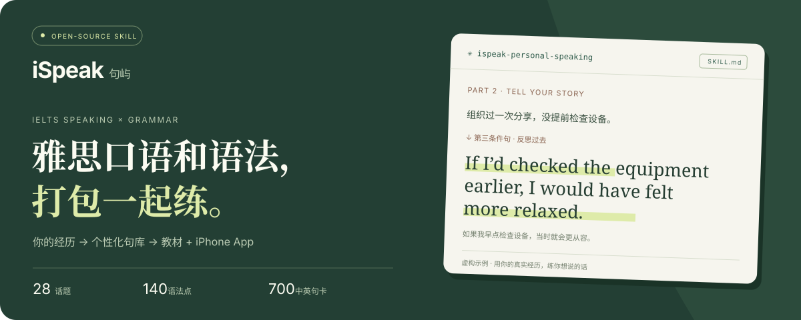
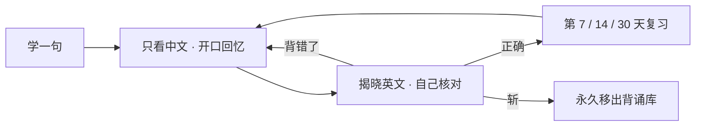
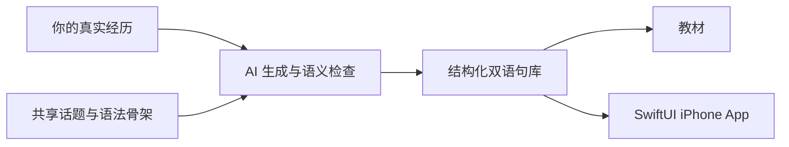

<div align="center">



# 你的故事，就是你的口语教材。

**iSpeak 是一个开源 Skill：让 AI 把真实经历写进语法练习，再生成专属 iPhone App。**

从日常问答，到讲述经历，再到表达观点。理解结构、开口造句、中文自查，在同一套材料里完成。

<a href="https://github.com/ChoneyChen/ispeak/releases/latest/download/ispeak-personal-speaking.zip"></a>

[官网](https://choneychen.github.io/ispeak/) · [直接使用通用版](https://choneychen.github.io/ispeak/app/) · [查看 Skill 指令](skills/ispeak-personal-speaking/SKILL.md)

**28 个话题　 /　 140 个语法点　 /　 700 张中英句卡　 /　 MIT 开源**

</div>

---

## 01 · 练口语时，就把语法用上

你可能知道过去完成时，也背过条件句；难的是，轮到讲自己的故事时，能自然地用出来。iSpeak 把**话题、语法和个人经历**放到一起：每一个结构，都有具体想表达的意思。

| 口语场景 | 你要表达什么 | 放进句子里练的语法 |
| :--- | :--- | :--- |
| **Part 1 · 日常问答** | 我的习惯、家乡、学习和工作 | 一般现在时、频率副词、比较级、原因从句 |
| **Part 2 · 讲述经历** | 发生了什么、当时的感受、事后的反思 | 过去时、过去完成时、定语从句、第三条件句 |
| **Part 3 · 表达观点** | 为什么、有什么影响、还有另一面吗 | 让步从句、条件句、情态动词、对比与因果 |

> **一条经历，怎么变成练习？** 以下是虚构示例。
>
> **你告诉 AI**：我组织过一次团队分享，没提前检查设备，临场有点慌。
>
> **语法点**：第三条件句，用来反思过去。
>
> **你的练习句**：**If I’d checked** the equipment earlier, **I would have felt** more relaxed.
>
> **中文回忆提示**：如果我早点检查设备，当时就会更从容。
>
> 接着换时间、换细节，开口讲完整经历。句卡是表达的起点。

## 02 · 下载 Skill，告诉 AI 你是谁

**更推荐个人版。** 共享的是课程骨架和应用架构，个性化的是你的经历、语境和想表达的意思。

**① [下载 Skill ZIP](https://github.com/ChoneyChen/ispeak/releases/latest/download/ispeak-personal-speaking.zip)**，解压并进入 `ispeak-personal-speaking` 文件夹，运行：

```sh
python3 scripts/install_skill.py
```

安装器默认放入当前用户的 Codex skills 目录，支持 `CODEX_HOME`；遇到已有同名技能会停止，避免覆盖。其他支持本地 Skill 的 AI 工具，可按其规则导入技能文件夹。

**② 新开一个聊天，调用 Skill。** 把下面的省略号换成你自己的信息：

```text
使用 $ispeak-personal-speaking。

我正在准备雅思口语。
我的身份是……平时喜欢……
我想讲的几段真实经历是……

请把口语话题和语法打包一起练，
生成我的个性化句库、双语教材，
以及能学习、背诵和复习的 iPhone App。
```

**③ AI 继续完成内容和工程。** 你提供几段可讲的经历，AI 提取事实、映射话题、逐章写作与检查，再生成教材和应用。也可以先做一小部分，或只生成教材。

<details>
<summary><b>习惯用 Git？从仓库安装</b></summary>

```sh
git clone https://github.com/ChoneyChen/ispeak.git
cd ispeak
python3 skills/ispeak-personal-speaking/scripts/install_skill.py
```

</details>

## 03 · 最后拿到什么？

| 双语句库 | 可读教材 | 专属 iPhone App |
| :--- | :--- | :--- |
| 默认 **700 句**，覆盖 28 话题与 140 语法点 | **HTML / Markdown / PDF**，语法说明与例句一起读 | **SwiftUI 原生工程**，复用现成的学习与复习架构 |
| 每句附中文提示与事实来源类别 | 附四步练法、12 时态、45 常见错误、30 天路线 | 滑卡、弹簧动画、朗读、触感反馈、本机存储 |

**一张卡，一次只专注一句。** 上半看语法，下半学例句；完成一个语法点的 5 句后，解锁这一节的背诵。



复习日期都从**首次背对**起算；错句保留，逾期仍待背，第 30 天再次背对后完成这轮复习。应用运行时无需模型 API key 或后台登录，学习进度保存在本机。个性化内容由调用 Skill 的宿主 AI 撰写。

## 04 · 也可以先用现成的通用版

| | **个人专用版 · 更推荐** | **通用版 · 打开即练** |
| :--- | :--- | :--- |
| 例句 | 围绕你的身份、兴趣和真实经历 | 700 句通用情境，第一人称均为练习设定 |
| 开始方式 | 下载 Skill，告诉 AI 你的经历 | 打开网页，可添加到 iPhone 主屏幕 |
| 交付 | 个性化句库、教材、原生 App 工程 | 离线网页应用；另提供原生通用版源码 |
| 适合 | 想练“自己真正会说的话” | 想先体验练法，或马上开始学习 |

**[打开 / 安装通用版 →](https://choneychen.github.io/ispeak/app/)**　 ·　 [下载原生通用版工程](https://github.com/ChoneyChen/ispeak/releases/latest/download/ispeak-general-ios-source.zip)　 ·　 [下载通用版 PDF 教材](https://github.com/ChoneyChen/ispeak/releases/latest/download/iSpeak-General-Guide.pdf)

通用网页应用：用 Safari 打开，分享 → 添加到主屏幕，首次在线打开以缓存资源。原生版：使用 **Mac + Xcode + 自己的 Apple 签名**构建安装；目前没有 App Store / TestFlight 或共享签名 IPA。

## 05 · 开放的，是一整套可复用框架

**只换内容，复用应用。** 课程 JSON 同时驱动教材和 SwiftUI 应用；学习引擎独立于个人经历，每位用户不用重新设计交互与排程。



<details>
<summary><b>查看资源目录、事实规则与架构细节</b></summary>

| 资源 | 内容 |
| :--- | :--- |
| [Skill 入口](skills/ispeak-personal-speaking/SKILL.md) | 完整个性化工作流与生成命令 |
| [课程骨架](skills/ispeak-personal-speaking/assets/grammar-catalog.json) | 28 话题、140 语法点、难度、句型与说明 |
| [通用句库](skills/ispeak-personal-speaking/assets/general-curriculum.json) | 700 句可直接使用的通用情境 |
| [内容与事实规则](skills/ispeak-personal-speaking/references/profile-and-content.md) | 事实清单、来源类别、双语写作与语义检查 |
| [原生应用架构](skills/ispeak-personal-speaking/references/ios-architecture.md) | 状态机、整节解锁、排程、本地存储与签名 |
| [交付与验证](skills/ispeak-personal-speaking/references/delivery-and-qa.md) | 内容、教材、构建、核心测试与 UI 路径 |

动作先保存再动画；纵向滚动不推进卡片；保留重启、保存失败和减少动态效果的处理。每句标明个人事实或情境练习；脚本检查结构与事实链接，AI 另检查英语、翻译和事实支持。

</details>

<details>
<summary><b>开发者：跑通 demo、生成通用版、检查与本地预览</b></summary>

15 句虚构 demo；在 Mac / Xcode 下生成教材、原生工程，并在模拟器运行：

```sh
python3 skills/ispeak-personal-speaking/scripts/demo.py --out ../ispeak-demo --pdf --run
```

生成完整 700 句原生通用版：

```sh
python3 skills/ispeak-personal-speaking/scripts/general.py --out ../ispeak-general --pdf --build
```

其他系统可省略 `--pdf --build/--run`，生成 JSON、HTML、Markdown 与源码。Python 工具只用标准库；PDF 渲染使用 macOS Swift/AppKit。

```sh
python3 -m http.server 4173 --directory docs
node tests/web-engine.test.mjs
python3 -m unittest discover -s skills/ispeak-personal-speaking/tests -v
```

官网为无构建依赖的静态页面，GitHub Pages 从 `main:/docs` 发布；`docs/app` 为离线网页通用版，`skills/` 为可独立安装和打包的技能。

</details>

---

<div align="center">

**从一句想说的话开始，把语法练成自己的表达。**

[下载 Skill](https://github.com/ChoneyChen/ispeak/releases/latest/download/ispeak-personal-speaking.zip) · [打开通用版](https://choneychen.github.io/ispeak/app/) · [MIT License](LICENSE)

</div>

<sub>独立开源学习项目，非 IELTS 官方题库，不承诺考试分数。代码与通用资源使用 MIT 许可；仓库不含原作者的私人画像、私人 PDF、个人句库或签名资料。你的个性化产物仍可能包含个人经历，是否交给模型处理取决于你选择的 AI 环境；使用框架不会自动将其公开。</sub>
