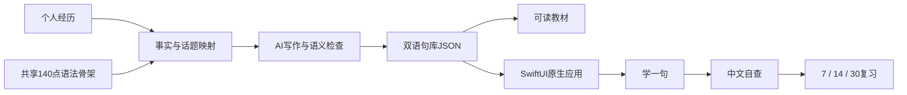

# 句屿 iSpeak · 口语和语法，打包一起练

**通用版打开即练；更推荐用 Skill，把真实经历做成个人口语专用版。**

[宣传官网](https://choneychen.github.io/ispeak/) · [打开 / 安装通用版](https://choneychen.github.io/ispeak/app/) · [下载 Skill](https://github.com/ChoneyChen/ispeak/releases/latest/download/ispeak-personal-speaking.zip)

把语法放进真正会用到的话题，先看懂一句，再换成自己的经历。共享课程为 **28 话题 × 5 语法点 × 5 中英例句 = 700 句**；应用把学习、中文自查和间隔复习串成闭环。

## 两个起点

| | 通用版 | 个人专用版，更推荐 |
|---|---|---|
| 内容 | 700 句通用情境，打开就能练 | AI 围绕你的身份、兴趣和真实经历写句子 |
| 使用 | 网页直接使用，可添加主屏幕并离线练习 | Skill 生成教材、双语句库、原生 SwiftUI iPhone App |
| 架构 | 学习、整节解锁、自查与 7/14/30 排程 | 复用已验证的原生界面、学习引擎与本地存储 |
| 个性化输入 | 无需提供经历 | 一段自己的背景和几段可讲的经历 |

通用版的第一人称句子都是练习情境，不代表用户真实经历。网页应用通过 Safari“添加到主屏幕”安装；当前没有 App Store/TestFlight 分发。原生 App 需要 Mac/Xcode 和使用者自己的 Apple 签名，仓库不提供共享证书或通用签名 IPA。

## 使用 Skill

克隆仓库并安装：

```sh
git clone https://github.com/ChoneyChen/ispeak.git
cd ispeak
python3 skills/ispeak-personal-speaking/scripts/install_skill.py
```

新开一个支持本地技能的聊天：

```text
使用 $ispeak-personal-speaking。
我的身份是……平时喜欢……最近经历过……
请把我的真实经历做成「口语 + 语法」个性化句库，
并生成学习、背诵与间隔复习的原生 iPhone 专用应用。
```

事实提取、逐章写作、语义检查、教材渲染、工程生成与验证由 skill 连续完成。应用运行时不需要模型 API key 或后台登录；AI 写作由调用 skill 的宿主模型完成。

[完整技能说明](skills/ispeak-personal-speaking/SKILL.md) · [内容与事实规则](skills/ispeak-personal-speaking/references/profile-and-content.md) · [原生应用架构](skills/ispeak-personal-speaking/references/ios-architecture.md)

## 开箱验证

在 Mac/Xcode 下，15 句虚构 demo：

```sh
python3 skills/ispeak-personal-speaking/scripts/demo.py --out ../ispeak-demo --pdf --run
```

生成完整 700 句原生通用版：

```sh
python3 skills/ispeak-personal-speaking/scripts/general.py --out ../ispeak-general --pdf --build
```

其他系统可省略 `--pdf --build/--run`，生成 JSON、HTML、Markdown 与源码。PDF 使用 macOS Swift/AppKit；Python 工具只依赖标准库。

## 为什么这套架构可以复用



- 课程和应用分离：更换内容，不必重写学习引擎。
- 一个语法点的 5 句学完才解锁；错句保留，正确排程，熟练可斩。
- 首次背对日期为 7/14/30 个日历日的共同基准，不是依次累加。
- 动作先保存再动画；纵向滚动不误触推进；考虑重启、损坏文件和保存失败。
- 个人事实有编号和来源类别，情境练习明确标记。结构校验不能代替英语、翻译和事实的语义检查。

## 本地开发与检查

```sh
python3 -m http.server 4173 --directory docs
node tests/web-engine.test.mjs
python3 -m unittest discover -s skills/ispeak-personal-speaking/tests -v
```

官网是无构建依赖的静态页面，GitHub Pages 从 `main:/docs` 发布。`docs/app` 是通用版离线网页应用，进度存于浏览器本机；`skills/` 是可独立安装和打包的完整 skill。

## 开源边界

[MIT License](LICENSE) 覆盖代码和通用教学资源。仓库不含原作者的私人画像、原版私人 PDF、私人故事、签名文件、设备 ID 或真实学习记录。个人化产物依旧包含用户自己的经历，不会因为缺少 profile 文件就自动匿名。

这些是学习材料与框架，不是官方 IELTS 题库，也不保证考试分数。请用真实经历改写、练习变化并开口连贯作答。
