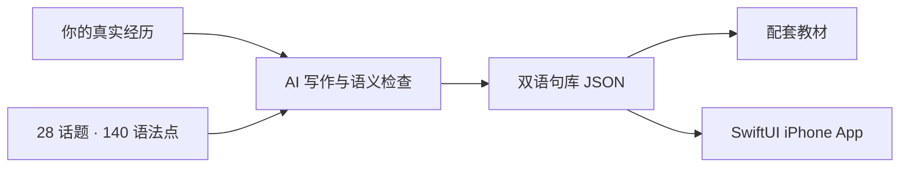

<div align="center">


# 你的故事，就是你的口语教材。

**给 AI 你的经历，带走一套「口语 + 语法」个性化学习系统。**

<a href="https://github.com/ChoneyChen/ispeak/releases/latest/download/ispeak-personal-speaking.zip"></a>

[项目主页与完整介绍](https://github.com/ChoneyChen/ispeak#readme) · [宣传官网](https://choneychen.github.io/ispeak/) · [直接使用通用版](https://choneychen.github.io/ispeak/app/)

**28 个话题　 /　 140 个语法点　 /　 700 张中英句卡　 /　 MIT 开源**

</div>

---

## 把语法，放进雅思口语真正想讲的话里

| 练习场景 | 表达目标 | 语法训练示例 |
| :--- | :--- | :--- |
| **Part 1 · 日常问答** | 讲身份、喜好、习惯与原因 | 一般现在时、频率副词、比较级、原因从句 |
| **Part 2 · 讲述经历** | 讲事情经过、感受与反思 | 过去时、过去完成时、定语从句、第三条件句 |
| **Part 3 · 表达观点** | 讲原因、影响和不同角度 | 让步从句、条件句、情态动词、对比与因果 |

> **虚构示例**：我组织过一次分享，没提前检查设备，临场有点慌。
>
> **第三条件句** → **If I’d checked** the equipment earlier, **I would have felt** more relaxed.
>
> **中文回忆提示** → 如果我早点检查设备，当时就会更从容。

同一个结构，换成你真实经历中的细节，练习变化并开口连贯作答。完整课程默认 **28 × 5 × 5 = 700 句**，也支持较小课程或用户已有材料。

## 01 · 安装并调用 Skill

下载 ZIP 并解压，进入本文件夹运行：

```sh
python3 scripts/install_skill.py
```

默认安装到当前用户的 Codex skills 目录，支持 `CODEX_HOME`；已有同名技能时会停止，避免覆盖。其他支持本地 Skill 的 AI 工具，可按其规则导入技能文件夹。

新开一个聊天，把下面的省略号换成你自己的信息：

```text
使用 $ispeak-personal-speaking。

我正在准备雅思口语。
我的身份是……平时喜欢……
我想讲的几段真实经历是……

请把口语话题和语法打包一起练，
生成我的个性化句库、双语教材，
以及能学习、背诵和复习的 iPhone App。
```

你主要提供经历，无需手填 700 句。AI 提取事实、映射话题、逐章写作与检查，再生成教材和应用；信息不足时集中补问。也可以只要教材，或先做一个小单元。个性化写作使用调用 Skill 的宿主模型，无需另配模型 API key。

## 02 · 你会得到什么？

| 个人双语句库 | 配套教材 | 原生 iPhone 应用 |
| :--- | :--- | :--- |
| 真实经历与共享语法骨架结合 | HTML / Markdown / PDF | SwiftUI 工程与可复用学习引擎 |
| 例句、中文提示、事实来源类别 | 四步练法、12 时态、45 常见错误、30 天路线 | 弹簧滑卡、朗读、触感反馈、本机进度 |

**学习闭环**：看语法与单句 → 学完一节 5 句 → 中文自查 → 揭晓核对 → 错句保留，正确复习，熟练可斩。

**复习规则**：以首次背对为基准，第 **7 / 14 / 30** 个日历日回库；逾期保留待背，第 30 天再次背对后完成这轮复习。应用离线运行，不需要后台登录或运行时 AI 调用。

**构建条件**：原生编译和安装需要 Mac / Xcode；真机使用自己的 Apple 签名。PDF 渲染使用 macOS Swift/AppKit。其他系统仍可生成 JSON、HTML、Markdown 和源码。当前没有共享签名 IPA 或 App Store / TestFlight 分发。

## 03 · 共享框架，只换你的内容



- **内容与应用分离**：替换句库即可复用界面、学习引擎与本地存储。
- **事实有来源**：明确区分已确认经历、通用表达、情境与假设；结构校验后另做英语、翻译和事实语义检查。
- **交互可复用**：每次一条，语法在上、例句在下；先保存再动画，纵向滚动不误触推进，支持减少动态效果。

| 深入阅读 | 用途 |
| :--- | :--- |
| [SKILL.md](SKILL.md) | AI 的入口指令与完整工作流 |
| [内容与事实指南](references/profile-and-content.md) | 画像、事实链接、写作质量与数据格式 |
| [原生应用架构](references/ios-architecture.md) | 状态机、排程、本地持久化与签名 |
| [交付与 QA](references/delivery-and-qa.md) | 教材、构建、核心测试与 UI 验证 |

<details>
<summary><b>开发者：一条命令体验虚构 demo</b></summary>

在 macOS / Xcode 环境生成带 PDF 的 **15 句虚构 demo**，复制应用模板并在模拟器编译运行：

```sh
python3 scripts/demo.py --out ../ispeak-demo --pdf --run
```

其他系统可体验导出和源码生成：

```sh
python3 scripts/demo.py --out ../ispeak-demo
```

生成 `Book/guide.html`、`Book/guide.md`、对应 JSON 和 `App/iSpeak.xcodeproj`。Python 脚本只依赖标准库。15 句是演示规模；完整个性化 700 句由调用 Skill 的 AI 撰写。

</details>

<details>
<summary><b>开发者：资源目录、完整流程与检查</b></summary>

| 路径 | 内容 |
| :--- | :--- |
| `assets/grammar-catalog.json` | 28 话题、140 语法点、难度与句型说明 |
| `assets/general-curriculum.json` | 700 句通用情境，可直接体验 |
| `assets/reference-library.json` | 四步练法、时态、常见错误与 30 天路线 |
| `assets/profile.example.json` / `demo-curriculum.json` | 完全虚构的画像与 15 句演示 |
| `assets/ios-template` | 原生应用模板、核心测试与 UI 测试 |
| `scripts/` | 计划、组装、校验、渲染、工程生成、构建安装与打包 |
| `tests/test_pipeline.py` | 数据、事实链接与包边界检查 |

AI 调用 Skill 时连续完成：

1. 在用户项目中建立 `profile.private.json`，区分已确认与未确认事实。
2. `prepare_curriculum.py plan` 映射事实，AI 逐章写作并检查双语表达。
3. `prepare_curriculum.py assemble` 组装，`validate_curriculum.py --mode full --profile ...` 检查 28/140/700 与事实链接。
4. `render_book.py --pdf` 生成教材和页码，`scaffold_app.py` 将 JSON/PDF 注入应用模板。
5. `project.py build/test/run` 验证。用户要求真机安装后，使用其设备与签名完成安装。

```sh
python3 -m unittest discover -s tests -v
bash ../ispeak-demo/App/scripts/test_core.sh
python3 scripts/project.py test --project ../ispeak-demo/App
```

结构校验不等于英语、翻译或事实语义正确，仍需按内容指南审查。

</details>

<details>
<summary><b>发布框架：生成带 SHA-256 清单的白名单包</b></summary>

```sh
python3 scripts/package_release.py --out ../ispeak-personal-speaking.zip
```

打包器排除工作输出并检查明显私密痕迹，只准备本地包，不创建远程仓库或上传资料。发布前仍应查看文件清单；个人画像、私人句库、教材、签名材料、设备编号和真机截图不属于公共资源。

</details>

## 想直接开始？先用通用版

**[打开 / 安装通用版 →](https://choneychen.github.io/ispeak/app/)**

700 句通用情境，打开就能练，通过 Safari 添加到主屏幕可作为离线网页应用使用；第一人称设定均为练习场景。**更推荐用 Skill 做个人版**，把通用句子换成自己真正想讲的内容。

完整原生通用版也可生成：

```sh
python3 scripts/general.py --out ../ispeak-general --pdf --build
```

---

<div align="center">

**口语和语法，打包一起练。把句子，说成自己的。**

[项目主页](https://github.com/ChoneyChen/ispeak) · [下载 Skill](https://github.com/ChoneyChen/ispeak/releases/latest/download/ispeak-personal-speaking.zip) · [MIT License](LICENSE)

</div>

<sub>独立开源学习项目，非 IELTS 官方题库，不承诺分数。代码和通用教学资源使用 MIT 许可。包内只分享通用框架与虚构示例；个人输入、个性化句子和第三方材料不会自动公开或改变许可。句库本身仍可能透露个人经历，是否交给模型处理取决于用户选择的 AI 环境。</sub>
