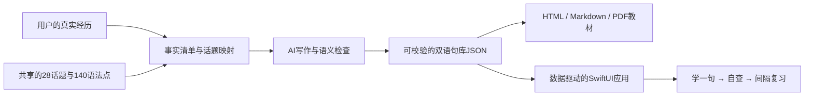

# iSpeak · 口语和语法，打包一起练

**通用版打开即练；更推荐告诉 AI 你的经历，用 Skill 制作个人口语专用版。**

[宣传官网](https://choneychen.github.io/ispeak/) · [直接使用 / 安装通用版](https://choneychen.github.io/ispeak/app/)

官网的通用版为可添加主屏幕的离线网页应用；下面的 Skill 生成原生 SwiftUI iPhone App。

这个 skill 将同一套课程框架、内容生产方法和原生应用架构开放出来。使用者主要提供自己的经历；AI 将其组织成自然的英文表达、中文回忆提示和可以离线运行的 iPhone 应用。无需为每个人重新设计学习引擎，也无需在应用中接入模型 API。

默认完整课程是 **28 个口语话题 × 每章 5 个语法点 × 每点 5 个中英例句 = 700 句**。也支持用户已有的材料和较小课程。这里只分享通用框架、教学资源与虚构 demo，不分发最初使用者的个人句库或 PDF。



## 为什么值得复用

- **围绕自己的意思学语法**：同一个结构在身份、经历和观点中反复使用；看懂、跟读、变形、开口，避免只有抽象规则。
- **内容和应用分离**：固定 SwiftUI + Codable + 本地状态机，替换句库即可换一个学习者。应用运行时不调用 AI，不需要后台服务器或登录。
- **学习与回忆形成闭环**：每次一条，语法在上、例句在下；滑完一节的 5 句才进入背诵。先中文、再揭晓；错误留下，正确排程，熟练可斩。
- **排程规则清楚**：从首次背对起算第 7/14/30 个日历日回库；支持逾期、重启、保存失败与永久掌握状态。
- **原生交互直接复用**：暖白纸感、深绿主色、弹簧滑卡、触感反馈、英文朗读、搜索、PDF 原页与减少动态效果支持。
- **生成链可检查**：每句带事实来源类别与 fact IDs；脚本校验数量、唯一性、完整性及事实链接，AI 另做英语/翻译/事实语义检查。情境练习明确标注。

## 安装 skill

把本文件夹放到本地之后，在其中运行：

```sh
python3 scripts/install_skill.py
```

默认安装到当前用户的 Codex skills 目录；支持 `CODEX_HOME`。已有同名 skill 时会停止，避免覆盖。新开一个聊天，客户端刷新技能列表后可调用：

```text
使用 $ispeak-personal-speaking。
我在一家小公司做设计，平时喜欢跑步。去年组织过内部分享，
也经历过一个延期项目。请围绕我的真实经历做完整口语句库，
并生成适配 iPhone 的学习、背诵与间隔复习应用。
```

也可以只要教材或先做一小部分。信息不够时，AI 会集中补问必要经历；无需用户手工填写 700 句。AI 内容写作由调用 skill 的宿主模型完成；这里的脚本不会绕过模型自行杜撰经历，也不需要单独配置模型密钥。

## 一条命令体验

在 macOS/Xcode 环境：

```sh
python3 scripts/demo.py --out ../ispeak-demo --pdf --run
```

这会从**虚构资料**生成带 PDF 的 **15 句 demo**，复制完整应用模板、自动选择可用 iPhone 模拟器、编译并运行。演示规模不是完整课程；个人化 700 句由调用 skill 的 AI 按 140 点骨架撰写。

无 macOS/Xcode 时仍可体验内容导出与源码生成：

```sh
python3 scripts/demo.py --out ../ispeak-demo
```

生成 `Book/guide.html`、`Book/guide.md`、匹配的 JSON 和 `App/iSpeak.xcodeproj`。所有 Python 脚本使用标准库，不需要 pip 安装；PDF 使用 macOS Swift/AppKit。iOS 原生编译和手机安装需要 Mac、Xcode、相应模拟器；真机安装还需要自己的 Apple 签名与连接设备。框架不随包提供这些账户或证书。

## 完整个性化流程

调用 skill 时由 AI 连续执行以下过程；这些命令也便于复现和排查：

1. 从用户输入建立工作目录中的 `profile.private.json`；以 `assets/profile.example.json` 为字段示例，不照搬虚构经历。
2. `prepare_curriculum.py plan` 将用户事实映射到共享目录；AI 逐章写作并检查英语、翻译和事实。
3. `prepare_curriculum.py assemble` 汇总章节并加入通用参考资料；`validate_curriculum.py --mode full --profile ...` 验证 28/140/700 与事实链接。
4. `render_book.py --pdf` 生成教材并重建页码；`scaffold_app.py` 将新的 JSON/PDF 注入模板，指定应用名和独立 bundle ID。
5. `project.py build/test/run` 完成本机验证。用户明确要求后，`project.py install` 使用其连接手机和自己的 team 安装。

具体数据格式、事实规则和命令见 [SKILL.md](SKILL.md) 与 [内容指南](references/profile-and-content.md)。应用的学习状态机、工程组成和签名边界见 [架构说明](references/ios-architecture.md)。

## 资源与验证

| 路径 | 用途 |
|---|---|
| `assets/grammar-catalog.json` | 28 话题、140 个语法点、难度、句型与说明 |
| `assets/reference-library.json` | 四步练法、12 时态、45 常见错误、30 天路线 |
| `assets/profile.example.json` / `demo-curriculum.json` | 完全虚构的 15 句端到端样例 |
| `assets/ios-template` | 可生成工程的原生应用、核心测试与 UI 测试 |
| `scripts/` | 计划、组装、校验、教材渲染、工程生成、构建安装与干净打包 |
| `tests/test_pipeline.py` | 数据、事实链接、打包边界与跨目录调用的回归检查 |

```sh
python3 -m unittest discover -s tests -v
bash ../ispeak-demo/App/scripts/test_core.sh
python3 scripts/project.py test --project ../ispeak-demo/App
```

源项目已实测安装到 iPhone 14 Pro。本公开模板会另用虚构内容进行构建和测试；具体检查与限制见 [交付 QA](references/delivery-and-qa.md)。完整学习应用并不意味着能保证任何 IELTS 分数；这里的练习不是官方题库，7/14/30 是框架默认复习规则。

## 开源与隐私

代码与包内通用教学资源使用 [MIT License](LICENSE)。用户输入、个性化句子和第三方原始材料不因使用框架而自动公开或改变许可。生成应用不会复制原始 profile，但句库本身仍可能透露个人经历。

要分发这个框架，创建带 SHA-256 清单的白名单包：

```sh
python3 scripts/package_release.py --out ../ispeak-personal-speaking.zip
```

打包器排除工作输出并拒绝明显私密痕迹；发布前仍应查看实际文件清单。个人 profile、原版私人 PDF、700 个私人例句、签名材料、设备编号、测试日志和真机截图都不属于公共资源。这个命令只准备包，不创建远程仓库或上传资料。

## 通用版与个人版

通用版提供 700 条明确标注的通用情境例句，可直接使用学习和背诵框架；所有第一人称设定都只是练习场景。更推荐通过本 skill 输入真实经历，生成自己的例句与原生 iPhone 专用应用。通用例句见 `assets/general-curriculum.json`，与个人版本复用同一目录和学习逻辑。

完整 700 句原生通用版工程也可一键生成：

```sh
python3 scripts/general.py --out ../ispeak-general --pdf --build
```
